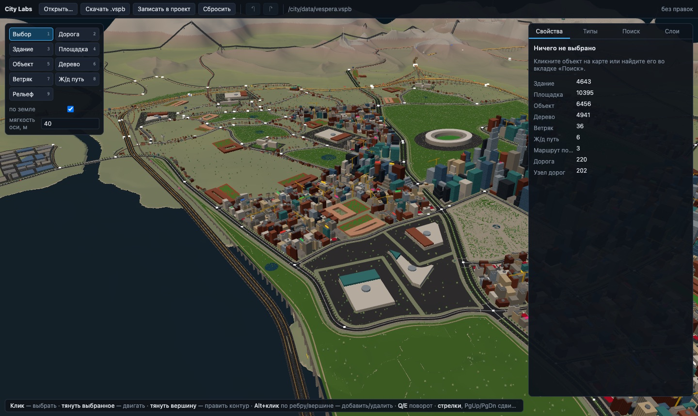
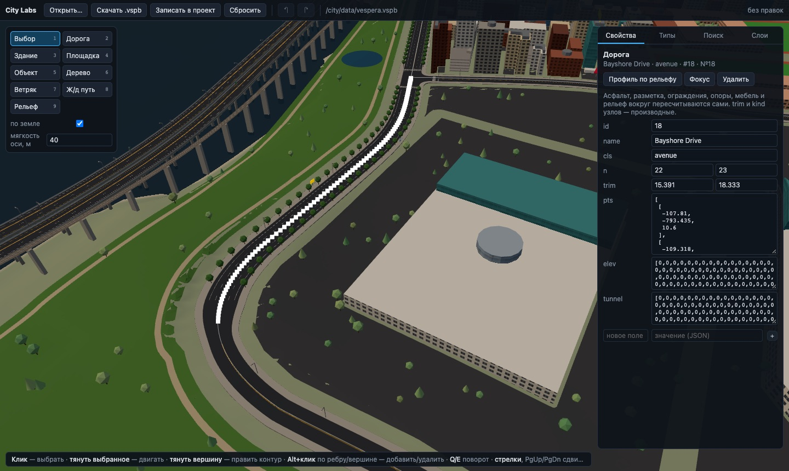

# City Labs

**City Labs is an editor for a game city.** It edits roads, terrain, buildings, ground patches,
roadside objects and the type registry of a whole city, Vespera Bay, a coastal city of about 9 × 9 km
with freeways, bridges and tunnels. Everything lives in one `.vspb` file. When you edit a road, the
asphalt, markings, junctions, pier bents, street lamps and the graded ground around it are rebuilt
on the spot. An AI agent can edit the same city over MCP: its edits appear live in the editor and
can be undone.

**Try it in the browser: [vicimpa.github.io/city-labs](https://vicimpa.github.io/city-labs/)**, or
install the desktop app (below).



## What it can do

- **Roads as a graph.** Draw a road with the class radius on its corners. Its ends attach to
  junctions or split the road they land on. Drag its axis with a soft falloff, re-level it over the
  terrain, and delete roads or junctions. Freeways, avenues, streets, rural and mountain roads come
  with lanes, markings, curbs, sidewalks, crash barriers, guardrails, tunnels and pier bents.
- **Terrain.** Raise, lower, smooth and flatten the natural ground. Roads keep their cuts and
  embankments.
- **City contents.** Edit building outlines with holes and stacked parts, ground patches, objects
  from prefabs, trees, railways and wind turbines: move, rotate, edit vertices, copy. Any field of
  any record can be edited, including ones the editor knows nothing about.
- **Types as data.** Materials and facades, building types, zones, ground covers, prefabs and road
  classes live in the file's registry. A new type needs no code.
- **One file.** The `.vspb` format is binary, extensible and backward compatible (spec:
  [docs/VSPB.md](docs/VSPB.md)). The world is about 9 MB, and the derived geometry is rebuilt on load.
- **MCP for agents.** 21 tools: search, read and write records, lay roads, edit the terrain and the
  registry, top-down maps of any area, generators, JavaScript scripts for bulk operations, save, and screenshots
  of the 3D view ([docs/APP.md](docs/APP.md)).
- **Generators.** Built-in generators take parameters: hilly terrain or an island, a street grid
  (block size, rotation, bend, avenues), buildings along streets by zone preset (downtown,
  midtown, residential, suburb, industrial), and tree patches. A whole run is one Ctrl+Z.
- **Scripts.** The Script tab runs JS over the world, with one undo step per run.
- **Start from an empty map.** A new map is 4 × 4 km of flat land with the full type registry.
  Vespera Bay opens with the **Sample** button.
- **Navigation.** Fly the camera with WASD (Shift is faster); the wheel zooms.
- **Russian and English UI.** The app window has no system title bar: its buttons sit in the
  editor's top bar.



## Install

Download the installer for your system from the
[latest release](https://github.com/vicimpa/city-labs/releases/latest):

| system | file |
| --- | --- |
| macOS (Apple Silicon / Intel) | `City-Labs-<version>-mac-arm64.dmg` / `-mac-x64.dmg` |
| Windows | `City-Labs-<version>-win-x64.exe` |
| Linux | `City-Labs-<version>-linux-x86_64.AppImage` (`chmod +x` it) |

The macOS builds are not signed by Apple. On the first launch, right-click the app and choose
**Open**, or run `xattr -dr com.apple.quarantine "/Applications/City Labs.app"`.

The app starts with a new empty map; **File → Open the sample** opens Vespera Bay. **File → New /
Open / Save / Save As** work on any `.vspb`. After installing, double-click a `.vspb` file (or use
Open With) to open it in City Labs: the installers register the file type.

### Updates

The app checks for updates at startup, behind a splash window, and then every 30 minutes:

- **A new version of the editor code** (`app-<version>.asar`) is downloaded, its checksum is verified
  and it starts on its own. While the app is running, an **"Update — restart"** button appears.
- **A new app build** (a different Electron or launcher) cannot be loaded that way. The app offers
  to download the installer, on the splash or with a **"New version — download"** button.

If a downloaded version fails to start, the app falls back to the version built into the installer.

## MCP

- **While the app is running**, its server is at `http://127.0.0.1:7357/mcp`. To add it to Claude Code:

  ```
  claude mcp add --transport http city-labs http://127.0.0.1:7357/mcp
  ```

- **In this repository**, the stdio server is already registered in `.mcp.json` (`node mcp/stdio.mjs`).
  If the app has the same file open, the server forwards every call to the app. Otherwise it edits
  the file headless.

## Development

```
npm install
npm run app          # the desktop app from source (Vite dev server inside)
npm run edit         # the editor in a browser (working copy in IndexedDB)
npm run build:web    # the web editor for GitHub Pages → dist-web/
npm run view         # the city viewer with a drivable car and 100 test cars
npm test             # format, MCP and the road builder
npm run test:app     # the desktop app end to end (Playwright Electron)
npm run dist         # installers for this system → release/
npm run test:update  # the installed app's updater against a local feed (after dist)
```

| folder | contents |
| --- | --- |
| `format/` | the `.vspb` codec and the city layer schema |
| `world/` | what is derived from the road graph: asphalt, junctions, bents, terrain grading, road furniture, profiles |
| `editor/` | the editor (three.js) |
| `viewer/` | the viewer, the 3D scene shared with the editor, car physics (Rapier) |
| `mcp/` | MCP tools and the stdio server |
| `app/` | the Electron app: `main.mjs` (window, files, MCP over HTTP), `boot/` (launcher, splash, updater) |
| `city/data/` | the city `vespera.vspb`; `legacy/` holds the last output of the old Python generator, kept as the reference for `npm run test:roads` |

### Releases

Bump the version, then push the tag:

```
npm version patch          # or minor / major
git push --follow-tags
```

Every push to `main` also publishes the web editor to GitHub Pages (the **Pages** workflow).

The **Release** workflow builds the installers for macOS, Windows and Linux, and the code bundle
`app-<version>.asar`. It publishes them to GitHub Releases with `manifest.json`, which installed
apps read.

**Raise `cityLabs.shell` in `package.json`** when the release changes Electron or the launcher
(`app/boot/`). Installed apps will then offer the installer. Everything else, including
`app/main.mjs`, `app/preload.cjs`, the editor and `world/`, ships in the code bundle and updates
itself.
