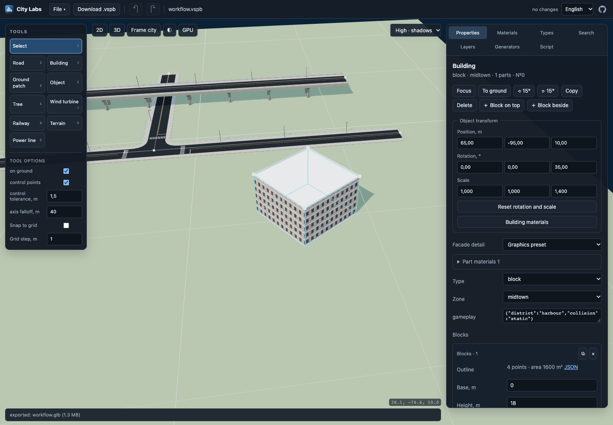

# City Labs

A browser and desktop editor for playable cities. Build roads, terrain, buildings and shared
materials in one `.vspb` document. Edit by hand or through MCP with the same validation and undo history.

[Open the browser editor](https://vicimpa.github.io/city-labs/) ·
[Download desktop installers](https://github.com/vicimpa/city-labs/releases/latest) ·
[Changelog](CHANGELOG.md)



## Features

- Road graph with smooth control-point editing, level-aware connections, bridges, tunnels,
  junctions, markings and automatically placed roadside objects.
- Local building and prop transforms, courtyard holes, stacked building parts and facade UVs
  that follow each object.
- PBR material library with previews, procedural facades and separate wall, roof and trim slots.
- Terrain brushes, architectural details, spatial batching, instancing, terrain LOD and quality
  presets with optional shadows.
- Shared type registries, search, generators, bulk scripts and undo/redo in Russian or English.
- VSPB 2 authoring format with v1 import and compact terrain storage; GLB, PNG and JSON export.
- MCP tools for live desktop editing and headless file operations.

Start with **File → New map**, or open **File → Sample city** for Vespera Bay. The browser keeps a
working copy in IndexedDB. Desktop uses native file dialogs and `.vspb` file associations.

## Development

Requires Node 24 or newer. Desktop development also needs Rust and the
[Tauri prerequisites](https://v2.tauri.app/start/prerequisites/).

```sh
npm ci
npm run dev          # local server, no browser window opened
npm run edit         # open the editor at http://localhost:5199/editor/
npm run view         # open the city viewer
npm run app          # Tauri desktop development
```

```sh
npm run build:web    # static browser editor in dist-web/
npm run build:app    # frontend, MCP bridge and portable Node resources
npm run dist         # installers in src-tauri/target/release/bundle/
```

Desktop installers include Node for the MCP bridge; users do not need a separate Node install.
macOS requires 13.5 or newer. macOS builds use ad-hoc signatures; Windows installers are unsigned.
Updates use complete installers.

## Tests

```sh
npm test             # unit and integration suites
npm run test:ui      # isolated headless browser workflows and rendering checks
npm run build:web
npm run test:web     # production deployment and shared viewer
npm run test:desktop # native resources, bridge and Rust tests
```

Tests live in `tests/unit/`, `tests/integration/` and `tests/browser/`. Golden files are in
`tests/fixtures/`; optional benchmarks are in `tests/benchmarks/`. Browser tests create disposable
contexts and local servers, then close them. Native dialogs and installed-app behavior require
separate platform checks.

## MCP

The desktop bridge listens at `http://127.0.0.1:7357/mcp`. The stdio entry point is
`node mcp/stdio.mjs [world.vspb]`, also configured in `.mcp.json`. It forwards to an open desktop
file when available and otherwise edits the file headlessly. See [Desktop and MCP](docs/APP.md)
for tools, scripting, authentication and file handling.

## Repository

| Directory | Responsibility |
|---|---|
| `format/` | VSPB codec, document schema, validation and local transforms |
| `world/` | Road graph, profiles, terrain grading and derived city geometry |
| `editor/` | Workspace, tools, inspector, commands, history and export |
| `viewer/` | Shared Three.js renderer, lighting, materials, LOD and driving preview |
| `mcp/` | Tool definitions, generators, scripts and file sessions |
| `desktop/` | MCP bridge, portable runtime configuration and desktop launcher |
| `src-tauri/` | Rust host, native lifecycle, file authority and packaging |
| `tools/` | Build, release, conversion and diagnostic utilities |
| `tests/` | Unit, integration, browser and benchmark suites with fixtures |
| `city/data/` | Bundled sample city |

[Architecture](docs/ARCHITECTURE.md) · [Road authoring](docs/ROADS.md) ·
[VSPB specification](docs/VSPB.md) · [Rendering performance](docs/PERFORMANCE.md)

## Releases

Keep `package.json`, `package-lock.json`, `src-tauri/Cargo.toml` and `src-tauri/Cargo.lock` on the
same version, and add its entry to `CHANGELOG.md`. Commit the changes, push `main` and wait for CI.
An annotated `v<version>` tag starts the release workflow.

The workflow checks the web editor and builds macOS ARM64/Intel, Windows x64 and Linux x64
installers. It publishes the release after every target and packaged macOS bridge check passes,
with changelog notes and a `SHA256SUMS` file. Pushes to `main` deploy the browser editor to Pages.
The portable Node version is pinned in `desktop/node-runtime.json`.

## License

[MIT](LICENSE) © 2026 vicimpa
